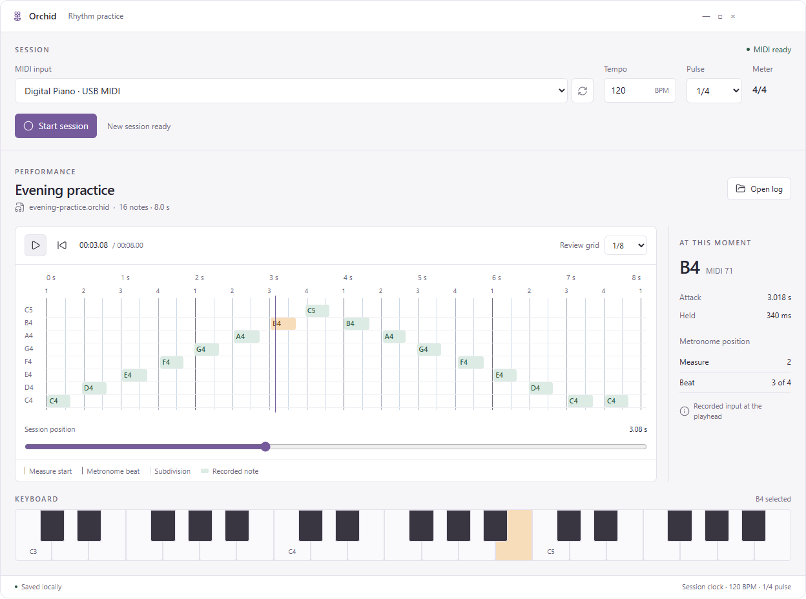
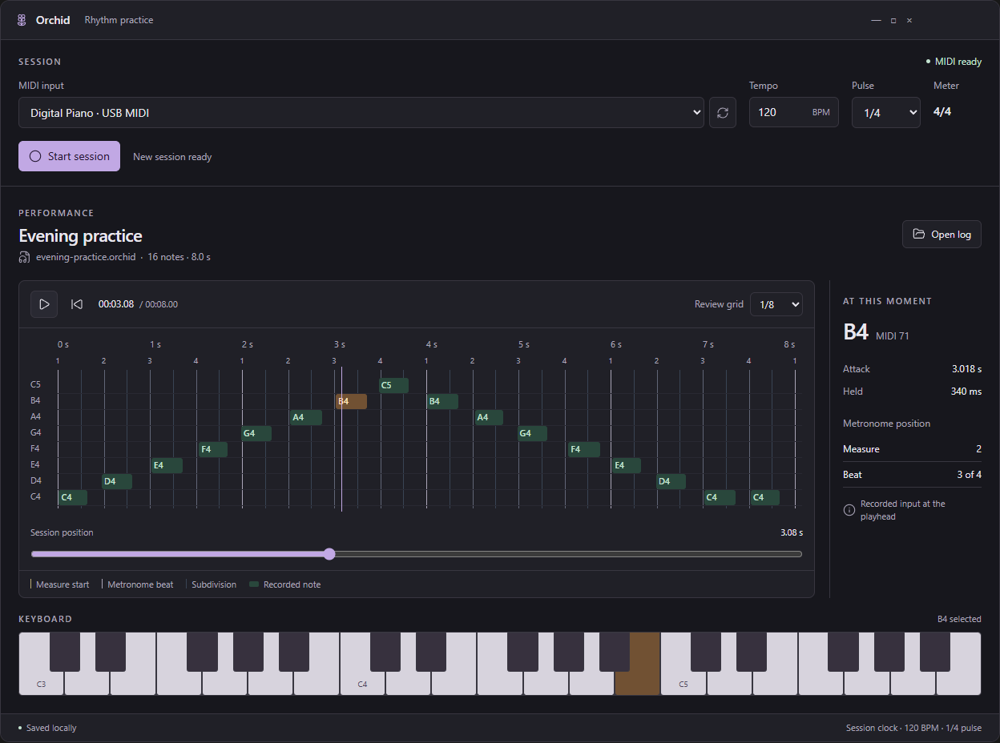
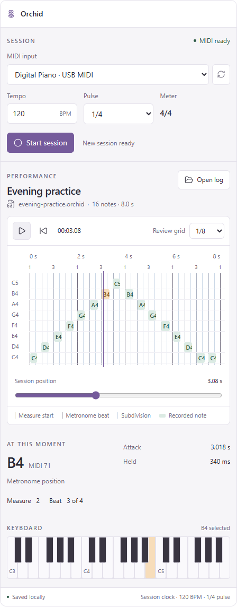
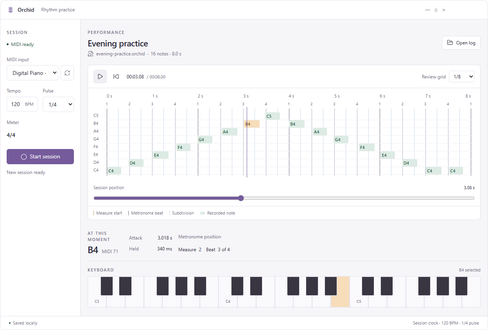

# Orchid: rhythm-session UI specification

Design handoff recorded on 2026-10-06. This specification captures the mockup discussed with the user and the latest product decisions in that conversation.

## Decisions and scope

- Product: Orchid, a MIDI piano practice application.
- Implementation direction: .NET MAUI, with shared C#/XAML views, styles, and interaction logic for Windows, macOS, Android, and iOS.
- Linux is not a first-version target. Keep musical/session logic independent of the UI framework so a Linux presentation layer can be added later.
- First version: inspect a recorded performance against time and metronome beats, with an arbitrary-position playhead and a panel showing the keys held at that exact moment.
- The user's longer-term objective is to reveal mistakes and compare performances with a reference. Reference comparison, correctness scores, and error classifications are later work. Do not infer wrong notes from the demo colors.
- The user liked the overall visual direction. The particular palette and the two layout alternatives remain design choices, not a finalized brand standard.
- Use **Workspace** as the primary visual reference. **Practice** is an alternative composition, not a required extra application screen. No explicit final choice between the two was made.

The user's latest first-version requirements take precedence over older proposed mechanisms in `docs/ui-mvp-philosophy.md`: a timeline with a time slider, visible elapsed time and metronome beat marks, and a piano below with octave labels on C keys. The design review of 2026-10-15 removed that piano: pitch is named by a label column at the timeline (see "Pitch axis and current-moment panel"). The selected-time panel shows actual held keys and metronome position. Closest-grid calculations from the older document are not a required panel in this first mockup.

## Visual references

For interaction, open `mockup.html`. The preview carousel selects the two variants; its controls must not become product navigation.

## Screen composition

### Workspace: primary desktop reference

The window has four states in one frame with a small title bar: Orchid icon and name, the state, and on the right the file or recording controls. Let the native host manage actual window controls and drag regions.

1. **Ready.** Session setup: MIDI input and refresh, tempo in BPM, pulse unit, fixed 4/4 meter, a one-line summary of the strong beats with Edit (strong-beats modal, see Shared components), count-in (default one bar, can be off) and Start session. Below it the last review, or an empty state that invites the first session and offers Open log.
2. **Count-in.** The live view with a large count instead of the bar number; recording starts on bar 1.
3. **Recording.** The live view (see "Live view").
4. **Review.** A header with the file name and save state, a toolbar (Play/Pause, Rewind, current and total time, note count, zoom out, zoom in, Fit, Follow, Fold empty pitches, grid settings), the timeline with its pitch label column, the "At this moment" panel on the right, and the overview strip under the timeline.

The header or a small footer carries recording, save and device feedback and the tempo/pulse context.

### Live view

The recording screen answers "where am I in the bar and what am I holding":

- The metronome is the dominant element: beat bars (the Shared components look, read-only) with the current beat lit, and the bar and beat number under them.
- The Held slot is the second, large element.
- Elapsed time is small, in the header next to the locked settings (lock icon, BPM, pulse, meter) and a large Stop with the Space shortcut.
- No keyboard, no note counter and no input activity light. A MIDI disconnect or audio failure appears as a banner under the header.
- Open: whether lighting the current beat in magenta distracts while playing; the alternative is a mark under the beat.

### Practice: alternative desktop reference

Session setup is a narrow column on the left. The remaining area holds the performance header, timeline, overview strip and a compact current-moment detail strip. This gives the timeline more vertical prominence. The alternative uses the same data and behavior as Workspace.

## Timeline and seeking

- Horizontal position represents elapsed time from the session start. Vertical lanes represent pitch, with note names at the left.
- Each note block begins at its actual attack time and extends for its actual held duration. Keep the stored timing; never snap recorded events to the grid for display or saving.
- Draw elapsed-time labels, measure boundaries, and metronome beat marks. In the initial 4/4, quarter-note-pulse example, beat labels repeat **1, 2, 3, 4** once per measure. The measure start has a bar line and its bar number on the ruler; other beats have lighter lines, and subdivisions are ruler ticks only. Beats the user marked strong are a tinted column, not a heavier line, and the measure start keeps its bar line even when its own beat is weak.
- Make the magenta vertical playhead visible above notes and grid lines. The **overview strip** under the timeline is the session-position control: the whole recording in miniature, the visible part as a frame and the playhead. A click or drag outside the frame seeks; dragging the frame moves the view. Show the selected time in the playback toolbar.
- Seeking updates the playhead, held-pitch marks, and current-moment details together, including silent gaps.
- Clicking a note seeks to its attack. Its details and the held-pitch marks then agree with the playhead.
- Playback advances this same session position. Pause holds it. Return to start sets it to zero. Playback and live capture must not create separate inconsistent clocks.
- Press-and-drag moves the view in both axes like a map, with the mouse, one finger or a pen: time horizontally, pitch vertically when the pitch range does not fit. A movement under 4 px is a click that selects a note. Dragging never moves the playhead and never scrolls the page instead of the timeline.
- For long recordings, retain a readable time scale and scroll the timeline. Do not compress an entire multi-minute recording into a few pixels per note. Zoom, the camera that follows the cursor, range fitting and the grid are specified in IMPLEMENTATION-DOD D10 and D12.

The demo is deliberately tiny: 16 notes over eight seconds at 120 BPM with a quarter-note pulse. Its fixed range and limited panning are not production limits.

### Timing and beat semantics

Use the same session origin for MIDI timestamps, metronome scheduling, the timeline, and the playhead. The first note does not reset the grid.

BPM counts the configured pulse unit. With pulse denominator `d`, one pulse lasts `60 / BPM` seconds, one quarter note lasts `(60 / BPM) * d / 4`, and a 4/4 measure lasts four quarter notes. At 120 BPM with a 1/4 pulse, beats are 0.5 seconds apart and a measure is two seconds. Review subdivisions do not change the metronome or recorded data.

If other pulse units are enabled, make actual metronome-click marks agree with that configuration; do not draw four click marks regardless of the pulse. The initial visual reference uses 1/4 and four beats per 4/4 measure.

## Pitch axis and current-moment panel

There is no piano keyboard. On a wide range the keys become a few pixels high and can be neither read nor used.

- A label column at the left of the timeline names the lanes: every lane when lanes are tall, only C otherwise. Pitches held at the position are marked in that column in the held color at any lane height.
- The default view fits the recorded range, with octave bands when lanes are thin and black-key rows when they are tall. After a pitch zoom, a narrow full-range strip beside the labels shows the visible window, and counts of notes above and below it appear. "Fold empty pitches" in the toolbar gives a lane only to pitches that occur in the recording; lane distance then no longer equals the interval, so the toggle stays visibly on.
- At position `t`, a key is held when `attack <= t < release`. At the exact release time it is no longer held. In a gap, show "No keys held".
- During live capture, show physical key state. During review and playback, derive it from the recorded intervals at the playhead.
- Close notes still held when Stop is pressed at the session-end time.
- Sustain pedal: key state stays physical. Review shows a pedal strip under the timeline with the pedal-down spans, and the part of a note that sounds only because of the pedal is a lighter tail after its key release. The Held slot lists held keys and shows pedal-sustained notes separately; the live view shows the pedal state next to it (IMPLEMENTATION-DOD D15).

### Held slot

One component in the live view and in "At this moment": a chord name when a chord recognizer supplies one (a separate future system, IMPLEMENTATION-DOD D13), and the held notes as chips, lowest first. Without a recognizer it shows the notes only; the UI never infers a chord itself. In review each note also shows its MIDI number, attack and duration. The panel shows bar and beat above the slot; a gap clears the fields.

## Layout stability

The interface never jumps. Only the window size, the wide/narrow reflow and an explicit user action (opening a panel or a modal) change geometry. Changing content never resizes or moves the timeline or a control: held notes from 0 to 10, chord names, times, bar and beat, file names and status messages. Panels have a fixed or bounded size and scroll inside; numbers use tabular figures in a reserved width; long text is truncated with a tooltip.

## Session and file states

Existing product notes propose the following supporting controls around the core review surface:

- Before recording: select a MIDI input and configure BPM, pulse, strong beats and count-in. Start requires an available selected input and runs the count-in; Stop during the count-in returns to Ready without a session.
- During recording: lock configuration and conflicting load/playback actions. Start becomes Stop. The timeline, overview, Play, Rewind and grid controls are hidden, not disabled; the live view takes their place (see "Live view").
- After Stop: stop capture and metronome, close held notes, present the recorded timeline, and compact the recording into the session file. While recording, every event is already in a write-ahead log.
- After a crash: the next start offers to recover the unfinished recording.
- Loading: show the loaded filename and duration; provide visible feedback for missing, invalid, or empty files.
- Empty recording: use an explicit empty state in the timeline, without fabricated demo notes.
- MIDI disconnect, audio failure, and save failure must be visible. Do not display successful saving just because a button was pressed.

These are production behaviors to implement against actual services. The HTML does not implement them beyond simulated UI state changes.

## Appearance

The visual goal is a calm practice workspace: quiet neutral surfaces, compact controls, small secondary labels, readable note marks, and restrained rounding. Give the timeline most of the visual attention.

Color carries one meaning per hue:

- Graphite neutrals for structure: surfaces, text, controls, grid lines and the strong-beat column.
- Steel blue for recorded notes.
- Magenta only for "now": the playhead (in the timeline and the overview), notes and pitches held at the position, Start/Stop recording and the brand icon. Nothing else uses it, including strong beats.
- No other hues. Errors and device status get their own treatment (icon, text and a color that is not magenta); it is not chosen yet.

Use explicit labels and a legend rather than color alone. The screenshots above predate this palette and still show the removed keyboard.

| Purpose | Token | Light | Dark |
| --- | --- | --- | --- |
| App background | `Background` | `#E3E4E8` | `#141416` |
| Panel / field surface | `Surface` | `#EDEEF1` | `#1C1D21` |
| Subtle surface | `SubtleSurface` | `#E6E7EB` | `#24252A` |
| Main text | `Text` | `#17181C` | `#E6E7EB` |
| Secondary text | `TextSecondary` | `#4D5058` | `#A2A4AC` |
| Border | `Border` | `#C6C8CF` | `#34363D` |
| "Now": playhead, overview playhead, Start/Stop, current beat, brand icon | `Accent` | `#C2185B` | `#FF6FA6` |
| Text on accent | `OnAccent` | `#FFFFFF` | `#2A0716` |
| Recorded-note fill | `NoteFill` | `#CDD6E2` | `#2F3B4C` |
| Recorded-note outline | `NoteStroke` | `#4A6587` | `#8EA5C4` |
| Recorded-note text | `NoteText` | `#22344B` | `#D8E1EE` |
| Note held at the position: fill | `SelectedFill` | `#C2185B` | `#E0407F` |
| Held note outline | `SelectedStroke` | `#7E0C3B` | `#FF9CC2` |
| Held note text | `SelectedText` | `#FFFFFF` | `#1A0510` |
| Bar line, strong block of the beat bars | `GridBar` | `#3E4048` | `#A9ABB3` |
| Beat line, line under C, ruler separator | `GridBeat` | `#C2C5CD` | `#2E3036` |
| Subdivision ruler tick, weak block of the beat bars | `GridTick` | `#7B7F89` | `#6C6F79` |
| Strong-beat column (ARGB) | `StrongBeatTint` | `#123E4048` | `#14A9ABB3` |
| Black-key rows in the timeline | `KeyRow` | `#E2E4E9` | `#212227` |
| Bar number plate | `BarLabelFill` | `#DADCE1` | `#2C2D33` |
| Bar number text | `BarLabelText` | `#26282E` | `#E1E2E7` |
| White key | `KeyWhite` | `#F3F4F6` | `#CFD1D8` |
| Black key | `KeyBlack` | `#2A2C33` | `#2A2C33` |
| Key label | `KeyLabel` | `#2A2C33` | `#2A2C33` |
| Held white key | `KeyHeld` | `#C2185B` | `#B0195A` |
| Held black key | `KeyHeldBlack` | `#E0407F` | `#E0407F` |
| Label on a held key | `KeyHeldText` | `#FFFFFF` | `#FFFFFF` |

Contrast requirements, checked for every pair above:

- Text and labels at least 4.5:1 against their background.
- Note outlines, the playhead, bar lines, ruler ticks, held fills and controls at least 3:1 against the surface they sit on.
- A held note differs from a recorded note by lightness, not only by hue, and stays distinguishable in a deuteranopia simulation (measured 4.0:1 light and 2.8:1 dark, 3.4:1 and 3.3:1 simulated).
- Light-theme surfaces are not pure white. Beat lines, key rows and note fills are deliberately faint; the bar line, the outlines and the tint carry the structure.
- One magenta cannot contrast with both a light white key and a dark black key, so held keys have their own fills.

Keep these as reusable theme resources (`Theme.xaml`, mirrored in `Orchid.Remote`). The `Key*` tokens serve the current keyboard drawing only and are removed with it; the held-pitch marks in the label column use `SelectedFill` and `SelectedText`.

Desktop reference sizes: about 22 logical pixels of content padding, 14-pixel body text, 11–12-pixel secondary labels, 22-pixel section titles, and 6–8-pixel control/panel corner radii. These are starting proportions, not fixed constraints. Use each platform's available system font rather than requiring Segoe UI everywhere. Support OS text scaling.

Use one consistent SVG icon family for flower/brand, refresh, record/stop, play/pause, rewind, open file, and information. The mockup uses Lucide. In MAUI, SVG files can be source assets and are converted to PNG resources during the normal build. Do not assume browser SVG rendering behavior applies to MAUI. The handoff's Lucide license is in `THIRD-PARTY-NOTICES.txt`.

## Adaptive behavior

- Wide desktop: timeline and current-moment panel sit beside each other.
- Medium window: move the moment panel below the timeline as a compact row; keep the timeline dominant.
- Narrow window: stack setup controls, performance header, timeline, overview and details. The phone design is a separate, reduced layout to be agreed later. Keep Start/Stop and time seeking reachable. Increase touch targets instead of reducing type to fit.
- Use the actual content width. The demo's transitions around 760 and 580 CSS pixels illustrate reflow; they are not mandatory MAUI breakpoints.
- Keep note names, time, beat information, and octave labels readable. Reduce secondary tick-label density when needed, preserving actual beat lines and the time mapping.
- Keep pitch labels readable on any range through the pitch-axis modes rather than by shrinking text.
- Geometry should respond to measured canvas size, OS scale, and safe areas. Avoid layout coordinates copied from one screenshot.

The narrow screenshot is a reflow reference. It is not an approved final phone screen or proof that all touch interactions are ready.

## MAUI implementation notes

- Build regular panels, fields and buttons with normal MAUI/XAML controls and shared resources.
- Implement the timeline, its label column and the overview strip as drawing controls, for example with `GraphicsView`/`IDrawable`. One transform maps time to x and pitch to y for rendering, hit testing, labels and the overview frame.
- Keep musical data and session state in the existing Core/Application responsibilities; keep presentation drawing and platform-specific input/audio outside them. Do not introduce extra architecture without a concrete need.
- All four targets can share views and themes. MIDI devices, audio output, permissions, deployment, and packaging still require appropriate platform implementations and verification.
- The current implementation state and its gaps are tracked in `IMPLEMENTATION-DOD.md`; treat the screenshots as intended UI, not proof that a feature exists.
- Use the repository's current `AGENTS.md` when implementing. In the inspected copy this includes English project-facing text, keeping platform code in the correct project, and working on a dedicated branch rather than committing directly to main.

Relevant documentation:

- [MAUI supported platforms](https://learn.microsoft.com/en-us/dotnet/maui/supported-platforms?view=net-maui-10.0)
- [MAUI graphics canvas](https://learn.microsoft.com/en-us/dotnet/maui/user-interface/graphics/?view=net-maui-10.0)
- [MAUI image and SVG resources](https://learn.microsoft.com/en-us/dotnet/maui/user-interface/images/images?view=net-maui-10.0)

## Shared components

Two small components are specified once so every screen and device renders them the same way: the PC window, the phone remote and a future control panel. They hold no application data and know nothing about each other. Reference implementations: `Orchid.UiPreview/ModalDialog.cs` and `BeatBars.cs` (MAUI), `Orchid.Remote/wwwroot/components/modal.js` and `beat-bars.js` (web).

### Modal

| Part | Rule |
| --- | --- |
| Inputs | `title`, `body` (any content), `isOpen` (or `open()` / `close()`) |
| Output | `closed` event after it closes, whatever the cause |
| Look | A dimmed scrim over the whole window or screen and one card with the title, a close button and the body. Card is centered with a maximum width of 560 px; on a phone (width up to 640 px) it is a sheet attached to the bottom edge |
| Dismiss | Close button, a click on the scrim, and Escape where a keyboard exists. A click inside the card never dismisses it |
| Focus | Focus moves into the dialog on open and back to the opener on close, and Tab stays inside while it is open. The web version gets this from `<dialog>`; the MAUI preview does not trap focus yet |
| Rules | One modal at a time. It owns no data: the host passes content in and keeps the state. It is not navigation |
| Touch | Close button at least 44 x 44 px |

Moving a setting to another screen or device means putting the same body content into that screen's modal; the modal itself does not change.

### Beat bars

| Part | Rule |
| --- | --- |
| Input | `beats`: array of booleans, one per beat of the measure, any length from 1 up. Also `disabled` |
| Output | `beatsChanged(newBeats)` with a **new** array each time |
| Look | One column per beat with its number under it. Each column has two blocks. A weak beat shows one filled soft block and an empty slot above it. A strong beat shows both blocks in the bar color (`GridBar`), so a strong beat is the tall bar; the weak block uses `GridTick`. Not the accent: magenta is reserved for "now" |
| Layout | Columns share the width equally. A block is at most 56 px wide and stays at least 28 px; a long measure wraps onto further rows. The count is the length of `beats`, so 3, 4, 6, 8 and 16 beats all lay out without configuration. (The MAUI preview does not wrap yet; it is fine up to 8 beats at the preview's 560 px card) |
| Interaction | The top block toggles the beat. The bottom block sets it to weak. Any beat may be strong, including none and all |
| Accessibility | Top block name: "Beat 3: strong, activate to make it weak" (or weak / strong). Bottom block name: "Beat 3: make weak". Strong and weak differ by block count and fill, not by color alone. Blocks are at least 44 px tall on touch |
| State | The component keeps nothing except the array it was given and the disabled flag. When the host sets a different length the bars are rebuilt |

## Acceptance examples for the first implementation

1. Seek into a note: the timeline playhead, time readout, current-note fields and the held-pitch mark agree.
2. Seek into a silent gap: no pitch remains marked and the panel says no keys are held.
3. Seek to an exact release: that key is no longer held. Overlapping recorded intervals mark their actual pitches; a chord name appears only from a recognizer.
4. At 120 BPM, 1/4 pulse, and 4/4, show four evenly spaced metronome beats per two-second measure; playback and recorded attacks share time zero.
5. Resize the window: controls remain accessible, details reflow, and note timing does not change. Seeking through 0 to 10 held keys moves nothing on screen.
6. Play, pause, and rewind: one shared playhead controls all review surfaces; no stale selection masquerades as current MIDI state.
7. Stop with a key held: its recorded interval ends at the session end. Save/load preserves timings.
8. Use an empty or invalid log / unavailable device: show an explicit state rather than invented data or a silent failure.

Reference-performance overlays, error scoring, chord recognition, note editing, and practice statistics are outside this first implementation.
